# Matching service: the architecture, explained so you can take it over

This is the **learning guide** for the matching microservice. `docs/MATCHING_SERVICE.md` is the *plan* (what to build and in what order); this page explains **why it is shaped the way it is**, what makes it a microservice, how architecture and design patterns differ, and how to change it safely.

How to read it: sections 1 to 4 give the big picture and the vocabulary. Sections 5 to 9 walk through one request and the failure cases. Section 10 is the code map. Section 12 is a cookbook ("I want to change X: what do I touch?"). The glossary is at the end.

**All diagrams are Mermaid text** inside this file. GitHub draws them; you edit them by changing the text (see section 14). There is no picture file to lose.

## 0. What exists today and what does not

Keep this table in mind: the diagrams show the **target**. Not all of it is built.

| Piece | Status | Where |
|---|---|---|
| Contract `jobify.matching.v1` (protobuf) | built, merged (M2, #101) | `services/matching/matching-api/src/main/proto/...` |
| `buf` lint and breaking-change checks in CI | built; the breaking comparison has not yet run against a real change | `.github/workflows/matching-service.yml` |
| Scoring function and ranking | built, merged (M3, #102) | `services/matching/matching-service/.../score/` |
| gRPC server: the three calls, limits, status codes, token check, health, reflection in dev | built (M4, #103); tested over a real socket | `matching-service/.../grpc/` |
| Dockerfile and compose entry (`--profile matching`) | written; **never built or run by the author** (no Docker here). A CI job builds and starts the image: check its first run | `services/matching/Dockerfile`, `docker-compose.yml`, `matching-service.yml` |
| Jobify side: `match/` slice, gRPC client, deadline, one retry, circuit breaker, 503, `GET /jobs/{id}/match` | built (M6, #105); tested against an in-process fake service, and run against the real service over a localhost network by `scripts/e2e-matching.sh` (M9) | `src/main/java/com/mcverse/jobify/match/` |
| Preferences endpoint | built, merged (M5, #104) | `job/service/SeekerPreferencesService` |
| `GET /jobs/recommended` (SQL narrowing to 200, `RankJobs`, paging) | built (M7, #106) | `MatchService.recommend`, `MatchCandidateRepository` |
| `GET /jobs/{id}/candidates` (applicants only, company access, `RankCandidates`) | built (M8, #107) | `MatchService.candidatesFor`, `MatchJobAccess` |
| Request id in both logs, metrics, end-to-end script (M9, #108) | built; `scripts/e2e-matching.sh` passes against both real services as jars | `RequestIdInterceptor`, `MatchGrpcService` meters, `scripts/e2e-matching.sh` |
| Running both in docker compose, calling with `grpcurl`, mutual TLS | **never verified / not built** (no Docker daemon or `grpcurl` where this was built) | |

---

## 1. The system in one picture

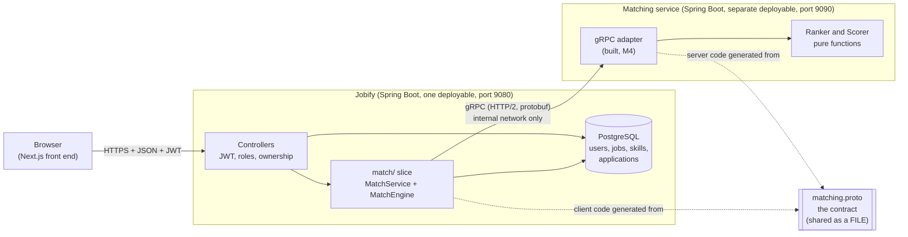

Read it left to right:

- The **browser** only ever talks to Jobify, in JSON, exactly as before. It never learns that a second service exists.
- **Jobify** is the system of record. It owns the database, the login, and every "may this person do this?" decision.
- The **matching service** owns one capability: *how well does this seeker fit this job?* It has **no database** and no idea who is logged in. Everything it needs arrives in the request.
- The **contract** (`matching.proto`) is the only thing both sides share. They share a *description of messages*, not code, a jar or tables. Each build generates its own stubs from the file: the service in `matching-api`, Jobify in its own `pom.xml` (it points the protobuf plugin at `services/matching/matching-api/src/main/proto`). That keeps the two builds independent: neither needs the other installed first. When the service moves to its own repository, the proto goes with it and Jobify takes a copy or a registry.

---

## 2. What makes it a microservice

"Microservice" is not a size. It is a set of properties. Here is each one, and whether this system really has it. Being honest about the gaps is the most useful part.

| Property | What it means | Do we have it? |
|---|---|---|
| **Own process, own deployable** | It starts, stops and is released on its own, with its own build and its own container. | **Yes.** `services/matching/` is a separate Maven project with its own `pom.xml`, jar, port (9090) and workflow. Jobify's `pom.xml` does not include it. |
| **One business capability** | It does one thing, named in the language of the business. | **Yes.** "Matching". Not "utilities" or "all calculations". |
| **Talks only over the network, through a contract** | No shared memory, no calling each other's classes. | **Yes.** gRPC and protobuf. The only shared artifact is the contract jar. |
| **Owns its own data** | No other service reads or writes its tables. | **Yes, trivially**: it has *no* data. It is stateless. The rule that matters is the reverse: the service never reads Jobify's database. |
| **Independently scalable** | You can run 5 copies of it without touching Jobify. | **Yes in principle**: it is stateless, so copies are interchangeable. Not tried. |
| **Fails independently** | When it is down, the rest of the system keeps working. | **Built (M6) for the one endpoint that exists, and proven against a fake service.** Only the match endpoints may fail, with a 503 and a clear message. Not yet shown against the real service on a network (M9). |
| **Technology freedom** | It could be written in another language. | **Yes by design**: the contract is language-neutral. We chose Java anyway. |
| **Independent team and release cadence** | Different teams ship on different days. | **No.** One repository, one person, one pull request at a time. |

**The honest summary: this is a "monolith plus one service", not a "microservices architecture".** A microservices architecture means *many* services with their own data and teams. We have two deployables, one of which is a monolith that calls the other. That is a perfectly good and common shape (some call it *service-based architecture*), and it is the right size to learn on. What we deliberately did **not** copy from big systems: service discovery, an API gateway, a message broker, a database per service, distributed tracing infrastructure.

### The price you pay (so you can judge it later)

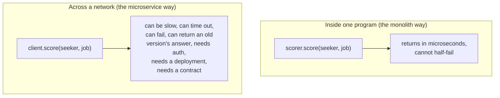

Every call that used to be a method call is now a *remote* call. The classic mistake is to forget this and treat it like a method. Almost every decision in this design (deadlines, one retry, circuit breaker, 503, narrowing to 200 jobs before sending) exists to answer one question: *what happens when the network part misbehaves?*

**When you would NOT do this**: for Jobify's size, a Java package inside the monolith would be simpler, faster and cheaper. We chose the service **to learn the costs and techniques first-hand**. The decision is recorded in `docs/MATCHING_SERVICE.md`.

---

## 3. Architecture vs design patterns, and the layer in between

This is the confusing part, because people use "architecture" and "pattern" for several different sizes of idea. Think of a **ladder of scale**. Each rung answers a different question, and a decision lives on exactly one rung.

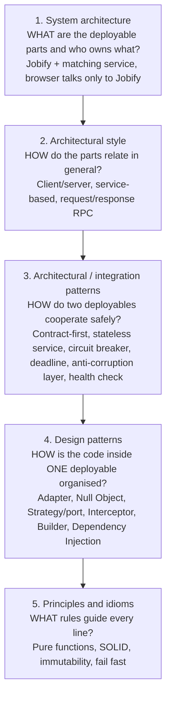

The rung people miss is **number 3**. A *design pattern* (rung 4) is about classes inside one program. An *architecture* (rungs 1 and 2) is about the big boxes. Between them sit **patterns that exist only because there is a network between two boxes**. Those are not in the classic "Gang of Four" book, because that book assumes one program. They come from the distributed-systems and integration literature. This is the layer the exercise is really about.

### The ladder, applied to this system

| Rung | Decision here | Why | Where to see it |
|---|---|---|---|
| 1 System | Two deployables. The browser talks only to Jobify. Jobify owns all data and permissions. | Keeps security in one place; the new service cannot leak what it never has. | section 1; `docs/MATCHING_SERVICE.md` section 2, "Rules 1 to 3" |
| 2 Style | Synchronous request/response over RPC (gRPC). | Scoring is a question with an immediate answer; nothing needs to be queued. | |
| 3 Integration | **Contract-first** | The `.proto` is written before any code, and tooling (`buf`) checks that changes do not break the other side. | `matching.proto`, `buf.yaml`, `matching-service.yml` |
| 3 Integration | **Stateless service** | No database means any copy can answer any request, and a crash loses nothing. | `matching-service` has no persistence dependency |
| 3 Integration | **Deadline (timeout)** | An unbounded wait lets one slow service freeze the caller. | built, M6: 800 ms per attempt for one job (`matching.deadline`); the 2 s ranking deadline is configured and used from M7 |
| 3 Integration | **Retry, once, only when safe** | Only on `UNAVAILABLE`; the calls are read-only so repeating them is harmless (idempotent). | built, M6: `GrpcMatchEngine.callWithOneRetry` |
| 3 Integration | **Circuit breaker** | After repeated failures stop calling for a while, so a dead service does not make every request wait out its deadline. | built, M6 (Resilience4j, `GrpcMatchEngine`) |
| 3 Integration | **Graceful degradation** | When matching is down, only matching features fail, with a readable 503, never a silent wrong answer. | built, M6: `ServiceUnavailableException`, mapped to 503 by `GlobalExceptionHandler` |
| 3 Integration | **Anti-corruption layer** | Jobify's entities are never sent over the wire. A mapper translates Jobify's model to the contract's messages, so neither side's internals leak into the other. | built, M6: `MatchFacts` (plain records) and the mapping in `GrpcMatchEngine` |
| 3 Integration | **Health check / readiness** | The platform asks "are you alive?" without calling real business endpoints. | built, M4: `grpc.health.v1` on 9090 (no token needed) and `/actuator/health` on 9091 |
| 3 Integration | **Shared-secret service authentication** | The service is internal, but it still checks who calls it. | built, M4: `TokenAuthInterceptor`; mutual TLS is a stretch goal |
| 3 Integration | **Correlation id** | One id (`x-request-id`) follows a user action through both services' logs. | built (M6 and M9): Jobify sends the request's `X-Request-Id`; the service logs it on every line of that call |
| 4 Design | **Pure function ("functional core")** | The score is computed with no I/O, clock or randomness, so it is trivial to test. | `score/Scorer.java` |
| 4 Design | **Port and adapter (hexagonal)** | Jobify depends on a small interface `MatchEngine`; `GrpcMatchEngine` is one adapter for it. | built, M6 |
| 4 Design | **Null Object** | `DisabledMatchEngine` answers "unavailable" so the rest of the code never checks for null or a feature flag. | built, M6: chosen by `matching.enabled` in `MatchConfig` |
| 4 Design | **Interceptor (chain of responsibility)** | The token check wraps every call without being written into each rpc. | built, M4: `TokenAuthInterceptor`, registered with `@GlobalServerInterceptor` |
| 4 Design | **Builder, immutable messages** | Protobuf generates them; you cannot change a message after building it. | everywhere in `score/` |
| 4 Design | **Dependency injection, constructor style** | `Scorer` gets its weights from outside, so tests pass different ones. | `Scorer`, `ScoringConfig` |
| 4 Design | **Configuration object** | The weights are a typed record bound from `matching.weights.*`. | `ScoringWeights` |
| 5 Principle | Make illegal states unrepresentable, fail fast, single responsibility | `Ranker` orders; `Scorer` scores; neither knows about gRPC. | |

**A rule of thumb for telling the rungs apart:** ask "*what breaks if I draw a network cable through this line?*" If the answer is "nothing, it is just classes", it is a design pattern (rung 4). If the answer is "now it needs a timeout / a version / a retry / a login", it belongs to rung 3. If the answer is "which team or process owns this?", it is rung 1 or 2.

### The two ideas to take away

1. **Architecture is the set of decisions that are expensive to change.** Moving a class is cheap. Changing the contract after another team depends on it is expensive. That is why the contract is checked by a tool and may only grow in compatible ways.
2. **Patterns are answers to recurring problems, not goals.** We use a circuit breaker because a dead dependency makes every request slow. If the failure never happened, the breaker would be useless complexity.

---

## 4. The contract: the real interface between the two sides

The contract is `services/matching/matching-api/src/main/proto/jobify/matching/v1/matching.proto`. It is the **single source of truth**. The Java classes on both sides are *generated* from it; nobody writes them by hand.

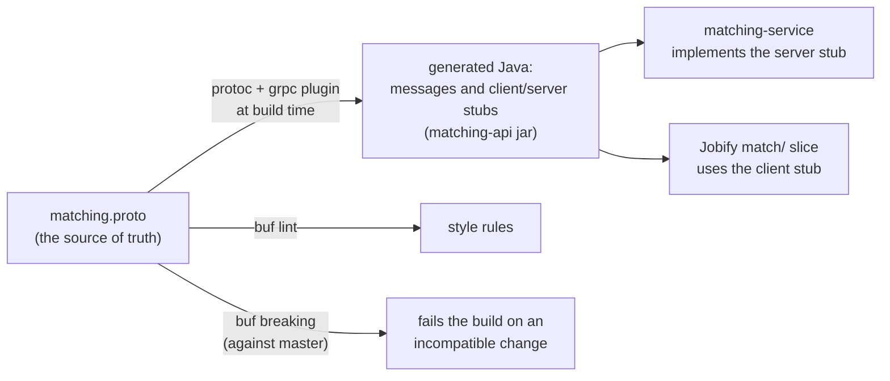

**The service has three calls:**

| Call | Input | Output | Used by |
|---|---|---|---|
| `Score` | one seeker, one job | one `Match` | `GET /jobs/{id}/match` |
| `RankJobs` | one seeker, up to 500 jobs, a limit | jobs sorted best first | `GET /jobs/recommended` |
| `RankCandidates` | one job, up to 500 seekers, a limit | seekers sorted best first | `GET /jobs/{id}/candidates` |

**A `Match`** holds the integer score 0 to 100, the matched and missing skill ids, and a list of `ScorePart` (key, weight, value, `counted`). That list is the *explanation*: it is how a seeker is told "this is a 76 because of skills, location, ...".

### Why protobuf and field numbers (the one thing to understand)

On the wire, a protobuf message does not carry field *names*. It carries field *numbers*. `seeker_id = 1` means "field 1 is the seeker id". This is why:

- You may **add** a field with a **new number** at any time. Old readers ignore what they do not know. Old writers simply leave it out, and the reader sees the default.
- You may **never reuse or renumber** a field, and never change its type. A reader built last month would silently read the wrong thing. This is exactly what `buf breaking` catches: it compares the current proto against `master` and fails if you broke it.
- You may **not change the meaning** of a field, even if tooling cannot detect it. That needs a code review.
- A real incompatible change means a new package `jobify.matching.v2`, served **next to** v1 until every caller has moved.

Other conventions in the file, and why:

- Enums start with `*_UNSPECIFIED = 0`. In proto3 the default value of an enum is 0, so "not set" must be a value that means "not set", never a real choice.
- Enum values are prefixed (`WORK_MODE_REMOTE`) because proto3 enum names share one namespace per package; `buf lint` requires it.
- `optional` fields (rates, experience level, whole `preferences`) distinguish "absent" from "zero". That distinction matters here: a missing pay range must mean "do not judge", while 0 means "the seeker said zero".
- Money is sent as an *annual equivalent in one currency*. Jobify converts hourly or monthly rates before sending, so the service has no unit logic.
- Unknown enum values from a newer Jobify are treated as "no data", never as an error, so a deploy order mistake does not take the feature down.

The **golden files** in `services/matching/golden/` are the same idea applied to tests: a request and the hand-checked response, as JSON. Both sides' tests read the same files, so a mapping mistake on either side shows up without starting both services. Read `golden/README.md`.

---

## 5. One request, start to finish (the target flow)

This is `GET /jobs/recommended` once M4 to M7 are built.

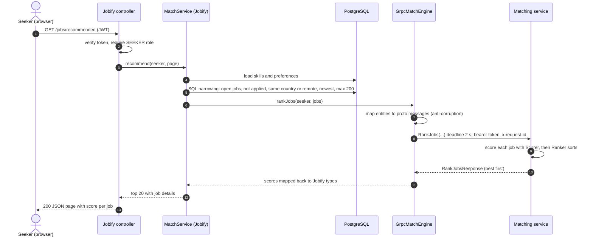

**Why each step is where it is**

- Steps 2 to 3: authentication and the role check happen in Jobify, *before* anything else. The matching service never sees a token that belongs to a user.
- Step 5: narrowing in SQL first. Sending 20 000 jobs across the network per request would be slow and wasteful; the database is good at filtering and the service is good at scoring, so each does its own job.
- Step 7: the mapper is the anti-corruption layer. If Jobify renames a column, only this mapper changes. The contract stays.
- Step 8: the deadline travels with the call. If the service is slow, the call is cancelled and the caller is not stuck.
- Steps 9 to 10: all the logic that is *business* (how to judge fit) lives in the service; everything that is *policy* (who may ask) lives in Jobify.

### What happens when it fails (the point of the exercise)

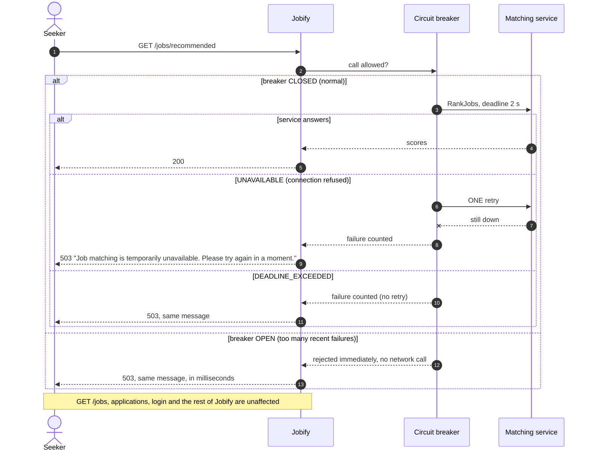

The breaker is a tiny state machine:

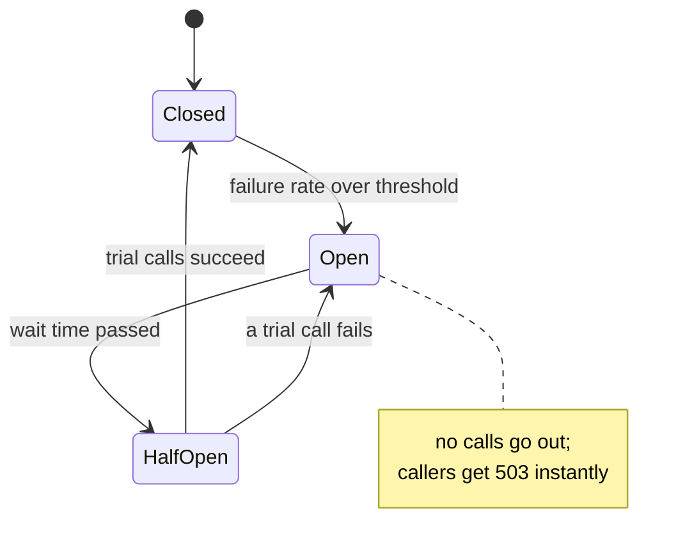

Decisions behind it (all recorded in the plan):

- **503 with a clear message, not a silent fallback list.** A fallback ("newest jobs") shown under the heading *Recommended* would be wrong and would hide the outage. The front end shows the message exactly as sent.
- **Retry only once and only on `UNAVAILABLE`.** More retries make an overloaded service worse (a "retry storm"). Retrying a timeout is dangerous because the first attempt may still be running. These calls are read-only, so one retry is safe.
- **Jobify has no `depends_on` the matching service in compose.** Jobify must start and work without it.

---

## 6. Inside the matching service

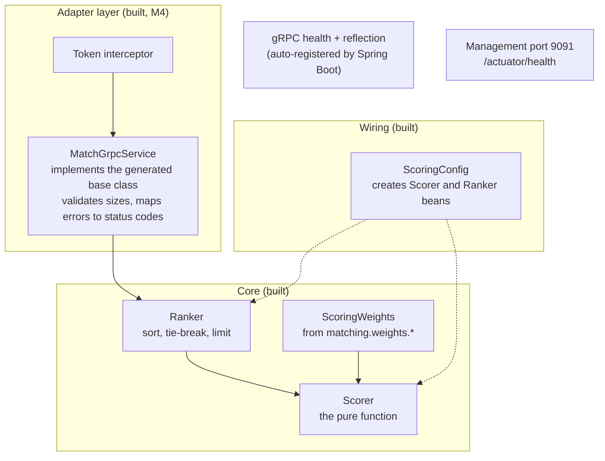

**The key design move: the core knows nothing about gRPC.** `Scorer` and `Ranker` take and return the generated message types, but they do not know about servers, ports, status codes or tokens. That is why they can be tested with plain JUnit in milliseconds and why you could expose the same core over REST or a queue tomorrow by writing a different adapter. Keep it that way: **never import a gRPC class into `score/`.**

### The scoring function in detail

Six parts, each judged 0 to 1, each with a weight:

| Part | Weight | Value |
|---|---|---|
| skills | 60 | average credit over the job's required skills |
| location | 10 | 1 if the job's country is in the seeker's countries, or the job is remote and the seeker accepts remote |
| work_mode | 8 | 1 if the job's mode is among the seeker's |
| employment_type | 7 | 1 if the job's type is among the seeker's |
| rate | 10 | 1 inside the seeker's range, falling linearly to 0 at 30% outside |
| experience | 5 | 1 same level, 0.5 one apart, 0 further |

`score = round( sum(weight x value over counted parts) / sum(weight over counted parts) x 100 )`

**The rule that shapes everything: missing data never punishes.** If a part cannot be judged (the seeker set no preference, or the job leaves a field empty), it is returned with `counted = false` and its weight leaves *both* sums. A seeker with no preferences is judged on skills alone; a job without a rate is not penalised for it. The response says which parts counted so the front end can show "based on skills only".

**Worked example** (this is `golden/score-basic`, run by `GoldenScoreTest`):

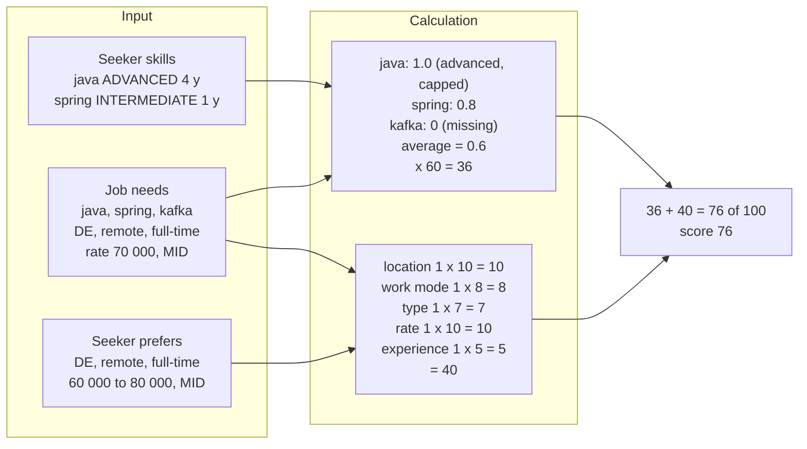

Skill credit: BEGINNER 0.5, INTERMEDIATE 0.8, ADVANCED or EXPERT 1.0, plus 0.1 for every year beyond 2, never above 1.0. The weights live in configuration, so tuning the balance does not need a code change.

**Ties** are ordered the same way every time: higher score, then the newer job, then the lower job id (for candidates: the seeker id). Determinism matters because the same page requested twice must not reshuffle.

---

## 7. Inside Jobify (the `match/` slice, built in M6; M7 and M8 extend it)

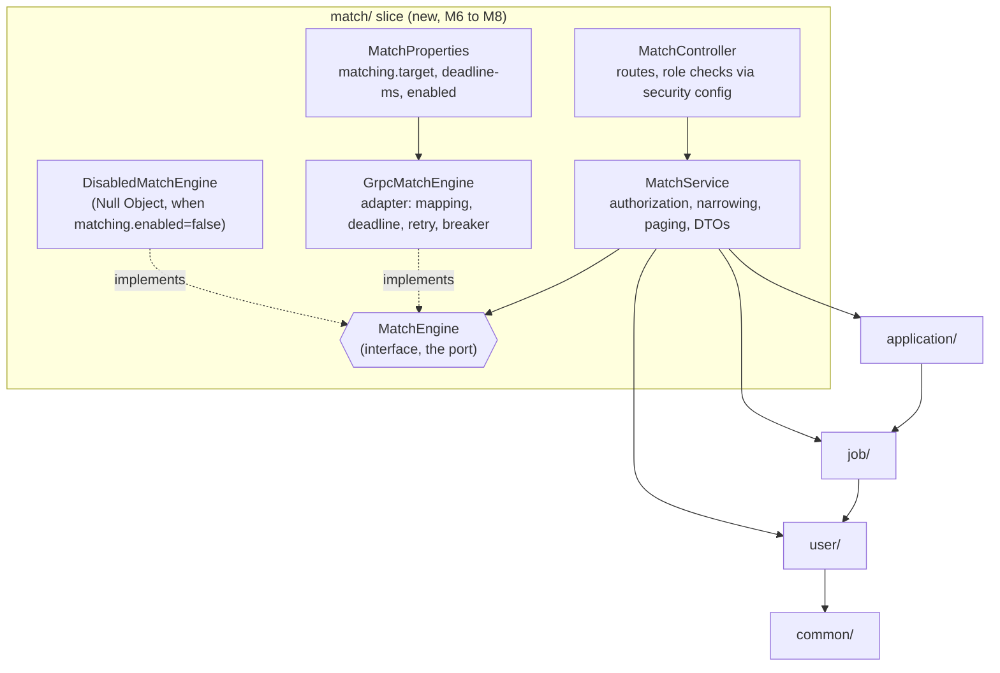

The existing rule in `CLAUDE.md` is that dependencies point one way: `company -> application -> job -> user -> common`. The new `match/` slice sits **on the outside**: it may use `application`, `job` and `user`, but **nothing may depend on it**. That is deliberate. If matching is ever removed or moved, deleting one package breaks nothing else.

`MatchEngine` is the port. Everything in Jobify talks to the interface; only `GrpcMatchEngine` knows gRPC exists. In tests, a fake `MatchEngine` replaces it, and a second set of tests runs `GrpcMatchEngine` against an in-process fake server that can be told to be slow or to fail.

---

## 8. Security

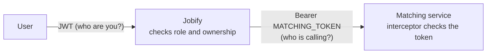

Two **different** questions are answered at two different places:

- *Which user is this, and may they do this?* Jobify, with the JWT. The matching service never sees a user, a name or an email. The request carries ids, skills and preferences only.
- *Is the caller really Jobify?* The matching service, with a shared secret (`MATCHING_TOKEN`) in the gRPC metadata. The service is only on the internal network, but "internal" is not a security model on its own.

The shared secret is the simple first step. The stretch goal is **mutual TLS**, where both sides prove their identity with certificates. If you get to M9, that is the best security lesson in the project.

Logs contain ids and request ids only, never names, emails or CV text.

---

## 9. Running it, and what is verified

| What | Value |
|---|---|
| Jobify | port 9080 (unchanged) |
| Matching gRPC | port 9090, **not published to the host**, reachable only inside the compose network |
| Matching HTTP | port 9091: `/actuator/health` only (later metrics). It is the service's only HTTP port |
| Settings on Jobify | `MATCHING_ENABLED`, `MATCHING_TARGET` (for example `matching:9090`), `MATCHING_TOKEN` |
| Setting on the service | `MATCHING_TOKEN`, `matching.weights.*` |

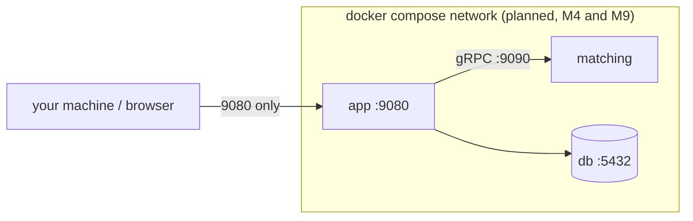

**Verified so far:** the contract builds, `buf lint` is clean, `buf breaking` flags a renamed field locally, 50 tests pass in the service, and a throwaway spike ran a Ping call and the standard health check on Spring Boot 4.1.1 with Java 21.
**Not verified:** anything involving Docker (no daemon in the build environment) and `grpcurl`. Treat compose and `grpcurl` as untested until you have run them (stories M4 and M9).

---

## 10. Code map

```
services/matching/                          independent Maven project (Jobify's root pom does not know it)
  pom.xml                                   parent; Spring Boot 4.1.1 manages grpc and protobuf versions
  buf.yaml                                  buf lint (STANDARD) and breaking (FILE) settings
  golden/                                   shared request/response JSON examples, and a README
  matching-api/                             THE CONTRACT
    src/main/proto/jobify/matching/v1/matching.proto
    src/test/.../GoldenContractTest         parses the golden requests, round-trips the wire format
  matching-service/                         THE SERVER
    .../MatchingApplication                 Spring Boot entry point
    .../grpc/MatchGrpcService               the adapter: validation, limits (500), status codes
    .../grpc/TokenAuthInterceptor           Bearer token check; health stays open; refuses to start without a token outside dev
    .../score/Scorer                        the pure function
    .../score/Ranker                        ordering, tie-breaks, limit
    .../score/ScoringWeights                typed configuration (matching.weights.*)
    .../score/ScoringConfig                 creates the beans
    src/test/.../score/*Test                scorer, ranker, config binding, golden score
    src/test/.../grpc/*Test                 adapter (direct), token rules, MatchingServerTest (real server over a socket)
  Dockerfile                                image build (context: services/matching)
.github/workflows/matching-service.yml      path-filtered CI: buf lint/breaking, then mvn verify
docs/MATCHING_SERVICE.md                    the plan, the stories, the decisions
docs/MATCHING_ARCHITECTURE.md               this guide
```

**Do not pin versions** of `grpc-java`, `protobuf-java` or the protobuf Maven plugin in these poms. Spring Boot manages a matching set; setting your own protobuf version broke compilation of the generated code in the spike.

### Tests, from the bottom up

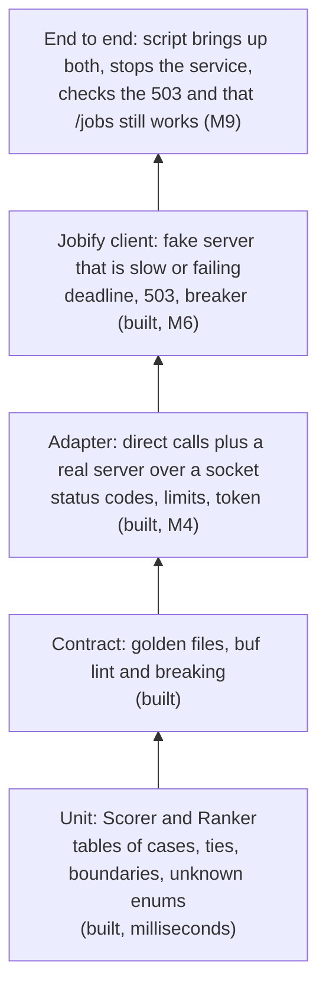

Many cheap tests at the bottom, few expensive ones at the top. When I wrote the scoring tests I also broke the scorer on purpose (changed the rate falloff, changed the experience half-credit) and checked the tests failed. A test that cannot fail proves nothing; do this whenever you add a rule.

---

## 11. Alternatives that were considered

| Choice | We chose | Alternative | Why not the alternative (for now) |
|---|---|---|---|
| Where the code lives | `services/matching/` in this repo | its own repository | One repository means one pull request can change contract and both sides together while learning. Extracting later is a `git subtree split`. |
| Protocol | gRPC and protobuf | REST and JSON; a message queue | Lets you learn contract-first and typed stubs. A queue fits event-style work (M10, M11), not a question that needs an answer now. |
| Language | Java 21 and Spring Boot 4.1 | Go, Python, Rust | Same toolchain you already know, so the lesson is the architecture, not a new language. The contract would allow switching later. |
| Data | none; profiles sent per request | service keeps its own copy, updated by events | Copies of personal data raise ownership and privacy questions. M11 exists but only if measured need appears. |
| Failure | 503 with a message | silent fallback | The fallback lies about what is being shown. |
| Candidates | applicants only | search all seekers | Searching everyone is a privacy decision of its own. |

---

## 12. Cookbook: "I want to change X, what do I touch?"

| I want to... | Touch | Then |
|---|---|---|
| Re-balance the score | `matching.weights.*` in the service's `application.properties` or an environment variable | no code change; restart the service |
| Change how a part is judged | `Scorer.java` (the matching `...Part` method) | add cases to `ScorerTest`; if a golden answer changes, **recompute it by hand** and edit `golden/*.response.json`; try breaking your change on purpose to prove the test fails |
| Add a new scoring part (for example "languages spoken") | 1) `matching.proto`: new field(s) **with new numbers**; 2) `ScoringWeights`: new weight; 3) `Scorer`: new `...Part`, added to the list; 4) tests and golden | run `buf lint` and `buf breaking` before pushing. Old Jobify versions simply do not send the field, so the new part is "not counted" for them, which is exactly right. Then update Jobify's mapper. |
| Add a new call | `matching.proto`: new `rpc` with `<Name>Request` and `<Name>Response`; implement it in the server adapter; add the client method in `MatchEngine` and `GrpcMatchEngine` | additive, so v1 stays compatible |
| Rename or remove a field | **Do not.** | Add a new field, stop sending the old one, remove it only in a new `v2` once nobody uses it |
| Change a limit (500) | the adapter (M4) and the contract comment | tell Jobify's side too |
| Run the service tests | `mvn -f services/matching/pom.xml verify` | |
| Check the contract | `buf lint` and `buf breaking --against '../../.git#branch=master,subdir=services/matching'` from `services/matching` (install `buf` 1.57.0) | |
| Run Jobify without the service | `matching.enabled=false` (the default in `dev`) | the three endpoints answer 503; everything else works |
| Extract the service to its own repository | `git subtree split --prefix=services/matching` | then publish `matching-api` as a package both sides depend on |
| Add a second service | copy the pattern: own folder, own pom, own contract package, own workflow, own port | resist sharing code between services; share contracts only |

### The traps (read before you edit)

1. **Never reuse a field number.** The most expensive mistake in this design, and invisible until two versions run side by side.
2. **Never put business rules in the adapter**, and **never put gRPC types in `score/`.** The core stays pure.
3. **Do not let Jobify call the service inside a database transaction.** A slow call would hold a connection. Load the data, leave the transaction, then call.
4. **Do not add a second reason for the two sides to share code.** A shared "common" library between services quietly turns them back into one program (a *distributed monolith*: all the cost of a network, none of the independence).
5. **Do not retry things that are not safe to repeat.** All current calls are read-only; a future call that writes needs an idempotency key first.
6. **Do not let unknown input crash the service.** An unknown skill id never matches; an unknown enum value is "no data". Keep that.

---

## 13. What to learn from it, in order

1. Read `matching.proto` slowly, then `golden/` (an example of every message).
2. Read `Scorer.java` next to section 6; change a weight in a test and watch the score move.
3. Read `ScorerTest`; add one case; then break `Scorer` on purpose and watch it fail.
4. Build M4 yourself: implement the generated `MatchServiceGrpc.MatchServiceImplBase`, delegate to `Ranker`. Use the in-process server in a test.
5. Read section 5's failure diagram, then stop the service while Jobify runs (M6, M9) and watch the 503 and the breaker.
6. Ask for each decision: *what is the cost, and what problem does it solve?* If you cannot name the problem, it is probably unnecessary.

Further reading (names, so you can search): *Release It!* by Michael Nygard (timeouts, circuit breakers, bulkheads); *Building Microservices* by Sam Newman; *Designing Data-Intensive Applications* by Martin Kleppmann (contracts and evolution); the "gRPC deadlines" and "Protocol Buffers: updating a message type" pages on grpc.io and protobuf.dev; "Hexagonal architecture" by Alistair Cockburn; "Monolith First" by Martin Fowler; Google's API design guide (the source of `buf`'s rules).

---

## 14. Editing the diagrams

Each diagram is a fenced code block starting with ` ```mermaid `. Edit the text, commit, and GitHub redraws it. To preview locally, paste a block into <https://mermaid.live>, or use the Mermaid preview in your editor. Syntax in one minute:

- `flowchart LR` (left to right) or `TB` (top to bottom); `A["label"] --> B["label"]`; `-.->` dotted; `A -- "text" --> B` labelled.
- `subgraph Name["Title"] ... end` draws a box around nodes.
- `sequenceDiagram` with `participant`, `A->>B: message`, `A-->>B: reply`, `alt ... else ... end` for branches.
- `stateDiagram-v2` with `A --> B: event`.
- Use `<br/>` for a line break inside a label. Quote labels that contain brackets or colons.

When the code changes, change the diagram in the same commit; section 0 is the place to mark what is built.

---

## Glossary

- **Adapter**: a class that translates between two interfaces (here: Jobify's `MatchEngine` and the generated gRPC client).
- **Anti-corruption layer**: a translation layer so one system's internal model does not leak into another's.
- **Circuit breaker**: stops calling a failing dependency for a while, so callers fail fast instead of waiting.
- **Contract-first**: writing the interface description before the code and generating code from it.
- **Deadline**: the moment after which a call is cancelled. In gRPC it travels with the call to the server.
- **Distributed monolith**: services that must be deployed and changed together; the cost of microservices without the benefit.
- **gRPC**: a remote-procedure-call framework over HTTP/2 using protobuf messages.
- **Idempotent**: safe to repeat; repeating it has the same effect as doing it once.
- **Interceptor**: code that wraps every call (here: the token check).
- **Metadata**: key/value headers on a gRPC call (here: `authorization`, `x-request-id`).
- **Null Object**: a do-nothing implementation used instead of null or a flag.
- **Port**: the interface your code depends on; **adapter** is what plugs into it.
- **Protobuf (Protocol Buffers)**: a compact, language-neutral message format described in `.proto` files.
- **Pure function**: same input, same output, no side effects.
- **Stateless**: keeps nothing between requests; any copy can serve any request.
- **Stub**: generated client or server code for a service.
- **`buf`**: a tool that lints `.proto` files and detects breaking changes.
